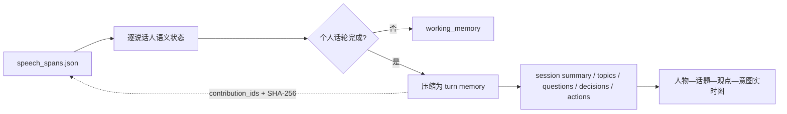

# 当前会话记忆与 VoiceMem 评审

日期：2026-09-20

## 结论

VoiceMem 对本项目有明显启发，但首版不直接安装或复制其实现。

采用的思想：

1. 原始发言作为证据保留，压缩记忆只保存来源 ID；
2. 写入发生在个人语义话轮完成之后，不由换人或静音触发；
3. 未完成发言留在短期 `working_memory`，不提前固化为观点；
4. 压缩结果保留人物、话题、意图、立场和证据关系，作为后续图结构的上层索引；
5. 记忆处理与音频前端解耦，未来可在回复路径之外异步运行。

不直接采用的部分：

- VoiceMem 的基础包同时安装 ASR、VAD、声纹、情绪、场景、本地 embedding、Mem0 和 Web 依赖，与现有 Sortformer/Qwen 前端重复；
- 上游固定 `transformers==4.52.3`，当前实验环境为 4.53.3，整包安装会改变已验证环境；
- VoiceMem 主要围绕一个长期用户的事实、偏好、人格和情绪记忆设计，本项目首版关注 3～4 人在单次现场对话中的独立观点和意图；
- VoiceMem 的七个固定槽位为 work、finance、relationships、health、goals、daily_life、knowledge，不适合作为会议中动态话题的一级分类；
- 当前项目已有说话人编号和语义话轮边界，重新使用 VoiceMem 的 FunASR、VAD 与声纹链路会丢失现有验证结果；
- 审查的上游版本为 0.2.3、提交 `6cacb3c1e7fca2679f3bf95451f6b480efd9a783`。核心左脑、编排器和图存储代码接近四千行，而该提交下只有两个测试文件，直接嵌入会显著扩大首版调试范围。

VoiceMem 使用 Apache-2.0，法律上允许复用；当前实现没有复制 VoiceMem 源码，因此不需要引入其运行依赖或派生代码声明。后续若直接移植具体文件，需要保留许可证与归属说明。

资料： [论文](https://arxiv.org/abs/2608.26005)、[GitHub](https://github.com/xzf-thu/VoiceMem)、[依赖清单](https://github.com/xzf-thu/VoiceMem/blob/main/pyproject.toml)。

## VoiceMem 中最有价值的设计

论文的左脑使用 schema → entity → memory item 两级轻量索引，先缩小候选集合，再让底层记忆引擎检索 Top-K。写入在话轮后异步完成，并保留 add / update / delete / keep 的更新语义。

实时检索分为：

1. 讲话过程中从部分转写匹配 schema 与 entity；
2. 静音约 200 ms 后开始预测可能需要回复；
3. 提前计算 embedding 并扩展一跳关系；
4. 在 VAD 确认结束前完成底层搜索。

这个“提前检索、确认后提交”的方式可以直接指导后续实时版本。但当前仍使用文件音频，首版先实现可靠写入；等麦克风与回复链路接入后再增加投机检索。

VoiceMem 的右脑把稳定人格与针对特定实体的情绪分开。这适合作为以后版本的情绪／关系记忆，不应在没有可靠声学情绪评测前加入当前首版。

## 当前实现

新增命令：

```bash
./lab build-memory dialogue_state.json \
  --memory-provider groq \
  --memory-proxy http://127.0.0.1:7890
```

数据流：



`session_memory.json` 包含：

- `turns`：每个已完成个人话轮的摘要、言语行为、意图、立场、话题、实体和原始贡献 ID；
- `working_memory`：仍未说完或未确认完整的逐人内容；
- `scene`：整体摘要、话题、未解决问题、决定和行动项；
- `source`：原始 `dialogue_state.json` 路径及 SHA-256；
- `stats`：原文与压缩文本量、已完成话轮数量和工作记忆人数。

压缩输出不重复保存完整原文；原文仍在 `dialogue_state.json`，每条记忆通过 `contribution_ids` 和 `source_text_sha256` 回溯。这样既压缩上下文，又不会失去审计依据。

本地 `--memory-provider local` 只提供无网络保底和结构验证，会保留原文式摘要，不作为真正压缩效果。Groq 使用严格 JSON Schema，并校验返回的话轮 ID 和所有证据 ID。

## 第一轮真实结果

输入为产业篇 102 秒中英素材，共 4 人、6 个已完成话轮：

- 生成 6 条逐人记忆；
- 没有未完成工作记忆；
- 没有虚构决定或行动项；
- 人物观点保持分开；
- 原始已完成文本 920 字符，压缩语义文本约为原始的 56%；
- 云端结构化压缩约 1.9 秒；该时间不在语音转写和回复的关键路径内。

模型首轮漏掉了音频末尾未回答的问题。模块已增加确定性约束：最后一个已完成话轮若为问题／请求且没有后续话轮，必须进入 `open_questions`。

中断场景也已验证：

- A 的“我觉得这个方案的主要问题是”与被 B 打断后的“成本太高”合并为同一条 A 话轮；
- D 的“小派你觉得这个方案”与被 B 打断后的“应该怎么改”合并为同一条 D 话轮；
- D 的合并话轮保留 `reply_requested=true`；
- B 的插话仍属于 B，没有进入 A 或 D 的记忆。

结果：[真实会议记忆](results/cctv-industry-qwen-overlap-15s-v2/session_memory.json)、[中断场景记忆](results/dialogue-interruption-request-memory-groq.json)

## 可视化图（已实现）

从 `session_memory.json` 直接投影首版可视化图：

- 节点：人物、话题、观点和意图；
- 边：`EXPRESSES`、`ABOUT`、`INTENDS`；
- 每条边保留 `turn_id`，点击观点可回溯人物、时间、立场和原始贡献 ID；
- `working_memory` 单独显示，不会在个人话轮完成前固化为观点；
- 页面每秒检查文件版本，记忆文件原子替换后自动重绘。

```bash
./lab visualize-memory results/某次运行/session_memory.json
```

端到端文件音频演示已合并为单一入口：

```bash
./lab demo data/prepared/cctv-robot-industry-30e19903a3e0.wav \
  --groq-proxy http://127.0.0.1:7890
```

融合模块会在每个稳定声学片段收尾时原子更新 `speech_spans.json`；常驻语义状态机只消费尚未处理的稳定片段，随后重建 `dialogue_state.json` 与 `session_memory.json`。限制 Qwen 显存的人工 ASR 窗口不会触发语义完成或观点写入。

首版使用 JSON 图和浏览器可视化即可，不引入图数据库。会话内只有几十到几百个节点，图数据库目前没有必要。
